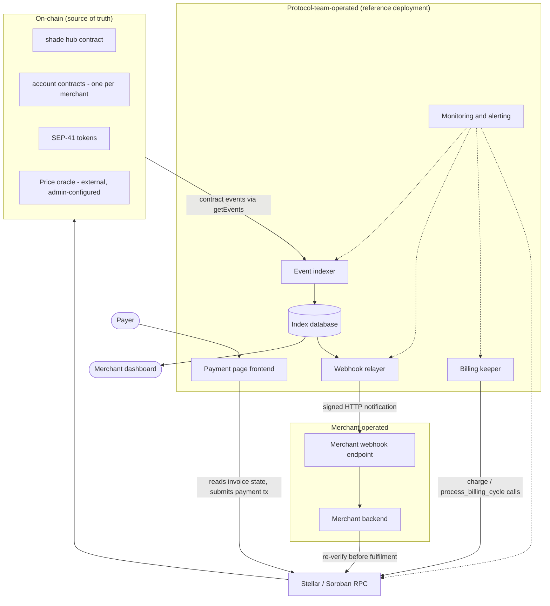

# Off-chain reference architecture

How the off-chain services around a production Shade deployment fit
together: what each one does, who operates it, what it consumes and
produces, what breaks when it fails, and — most importantly — what it is
**not** trusted to decide. The on-chain contracts are the source of truth
for every fact that moves money; everything off-chain observes, notifies,
drives, or displays.

For the on-chain side, read the [architecture overview](overview.md)
first. Shade does not ship any of these off-chain components in this
repository — the [event indexing guide](../guides/indexing-events.md),
the [webhooks guide](../guides/webhooks.md), and the
[billing keeper guide](../../example/docs/operations/billing-keeper.md)
document the mechanisms each component is built against.

## Component diagram

## Components

### Stellar / Soroban RPC endpoint

- **Responsibilities:** The single bridge between everything off-chain
  and the ledger: transaction submission, contract reads, and the
  `getEvents` stream the indexer consumes.
- **Inputs:** Signed transactions and read requests from the payment
  page, keeper, and merchant backends; event queries from the indexer.
- **Outputs:** Ledger state, transaction results, and contract events.
- **Failure impact:** Total but obvious — no payments, no reads, no new
  indexed data. Nothing off-chain can proceed, and nothing is silently
  wrong: every consumer can see the endpoint is down.
- **Operated by:** The protocol team for the reference deployment, or a
  third-party RPC provider. Merchants doing their own verification reads
  should run or choose their own endpoint (see trust boundaries).

### Event indexer

- **Responsibilities:** Follows the `shade` contract's event stream via
  RPC `getEvents` (filtering by contract id and event topic), decodes
  events into queryable rows, tracks its ledger cursor, detects gaps,
  backfills, and reconciles against on-chain state — as specified in the
  [event indexing guide](../guides/indexing-events.md).
- **Inputs:** Contract events from RPC, starting at a recorded
  `startLedger` cursor.
- **Outputs:** Indexed payment, invoice, refund, and subscription events
  in the database; the event feed the webhook relayer delivers from.
- **Failure impact:** Dashboards and notifications go stale; **no funds
  are affected**. Payments still settle on-chain. On recovery the indexer
  backfills from its last cursor, so the impact is delay, not loss —
  provided consumers treat stale data as stale (see trust boundaries).
- **Operated by:** The protocol team in the reference deployment. A
  merchant may run a private indexer instead of consuming the shared one.

### Index database

- **Responsibilities:** Stores decoded events and derived aggregates
  (payment history, invoice status mirrors, analytics views) in the
  schema the indexing guide recommends.
- **Inputs:** Writes from the indexer only.
- **Outputs:** Reads for merchant dashboards, the relayer's delivery
  queue, and operator reconciliation reports.
- **Failure impact:** Same shape as an indexer outage — everything
  downstream is stale or unavailable, nothing on-chain changes. The
  database is a rebuildable cache: worst case, it can be dropped and
  re-indexed from the contract's event history.
- **Operated by:** Whoever operates the indexer it belongs to.

### Webhook relayer

- **Responsibilities:** Turns indexed events into HTTP notifications to
  the webhook URL each merchant registered on-chain with
  `set_merchant_webhook`, with retries and delivery records. The contract
  itself stores the URL and emits events — it never makes an HTTP
  request; delivery is entirely this service's job, per the
  [webhooks guide](../guides/webhooks.md).
- **Inputs:** Newly indexed events and each merchant's on-chain webhook
  configuration.
- **Outputs:** Signed HTTP POSTs to merchant webhook endpoints, plus a
  delivery log merchants and operators can inspect.
- **Failure impact:** Merchants stop hearing about payments in real time.
  Payments still settle; a merchant who reconciles against on-chain state
  (or polls the index) is delayed, not deceived. Undelivered notifications
  must be replayable from the delivery log after an outage.
- **Operated by:** The protocol team in the reference deployment.

### Billing keeper

- **Responsibilities:** Drives recurring billing. Nothing in the
  subscription contracts charges itself — the keeper watches for due
  subscriptions and calls `charge`, `process_charge`, or
  `process_billing_cycle` (and the hub's `charge_subscription`) when a
  renewal, grace-period entry, recovery, or termination is due, as
  described in the [billing keeper guide](../../example/docs/operations/billing-keeper.md).
- **Inputs:** The schedule of due subscriptions (from on-chain state via
  RPC, optionally mirrored in the index).
- **Outputs:** Charge transactions submitted to RPC; outcomes recorded
  for monitoring.
- **Failure impact:** Renewals are late. Subscriptions drift into grace
  periods they should not have entered, but the contract's own rules
  (allowances, due checks, terminal-state panics) bound what a late — or
  over-eager — keeper can do: it can trigger charges, never authorise
  them.
- **Operated by:** The protocol team for protocol-hosted subscriptions;
  a merchant running their own subscription deployment operates their
  own keeper.

### Payment page frontend

- **Responsibilities:** The hosted page a payer lands on to pay an
  invoice: reads invoice state, presents amount and asset (including
  fiat-priced amounts via the oracle-priced invoice data), collects the
  payer's signature through their wallet, and submits the payment
  transaction.
- **Inputs:** An invoice id (typically via link or QR from the merchant);
  invoice state read through RPC.
- **Outputs:** A signed payment transaction submitted to RPC, and the
  confirmed result shown to the payer.
- **Failure impact:** Payers cannot pay through the hosted page until it
  is back. Invoices remain payable by any other client that can build
  the same transaction — the page is a convenience, not a gatekeeper.
- **Operated by:** The protocol team hosts the reference payment page;
  merchants may self-host or embed their own equivalent.

### Merchant backend

- **Responsibilities:** The merchant's own systems: creating invoices,
  receiving webhook notifications, verifying them against on-chain state,
  fulfilling orders or crediting accounts, and initiating refunds or
  withdrawals through the merchant's `account` contract.
- **Inputs:** Webhook deliveries from the relayer; the merchant's own
  order/commerce state.
- **Outputs:** Invoice-creation and refund transactions; fulfilment
  decisions.
- **Failure impact:** Merchant-local: that merchant's fulfilment stalls.
  No other merchant and no protocol component is affected.
- **Operated by:** The merchant, always. The protocol team never runs
  merchant backends and never holds merchant credentials.

### Monitoring and alerting

- **Responsibilities:** Watches the seams: indexer ledger lag versus
  the RPC head, relayer delivery failure rates, keeper missed or failed
  charges, RPC error rates, and database growth. Alerts operators before
  staleness becomes a merchant-visible incident.
- **Inputs:** Metrics and logs from every other off-chain component.
- **Outputs:** Alerts and operator dashboards.
- **Failure impact:** Nothing stops, but every other failure lasts
  longer before anyone notices. Monitoring is the difference between a
  five-minute indexer restart and a day of stale dashboards.
- **Operated by:** Whoever operates the component being monitored.

## Ownership summary

| Component | Protocol team | Merchant |
|---|---|---|
| Stellar / Soroban RPC | Reference endpoint | May run their own for verification |
| Event indexer | Reference deployment | Optional private indexer |
| Index database | With the reference indexer | With a private indexer |
| Webhook relayer | Yes | No |
| Billing keeper | Protocol-hosted subscriptions | Self-hosted subscription deployments |
| Payment page frontend | Reference hosted page | May self-host or embed |
| Merchant backend | Never | Always |
| Monitoring | For protocol-operated components | For merchant-operated components |

## Trust boundaries

The rule that organises everything above: **the contracts are the only
source of truth; off-chain data is a cache with a freshness timestamp,
not evidence.**

- **Never settle on indexer data alone.** The indexer can lag, miss a
  range during an outage, or be rebuilt. Before releasing goods,
  crediting a balance, or marking an invoice paid in a way that cannot
  be undone, re-verify the decisive fact on-chain: read the invoice or
  payment state from the contract through RPC, or reconcile the specific
  transaction hash. The contract also keeps on-chain analytics and
  transaction history (see
  [analytics and history](../concepts/analytics-and-history.md)) that can
  be cross-checked against the index.
- **A webhook is a hint, not a proof.** A delivered notification tells
  the merchant backend *that something probably happened*. The backend
  must confirm the payment on-chain before fulfilling, and must treat
  duplicate, replayed, and out-of-order deliveries as normal.
- **The keeper can trigger, never authorise.** Every charge still passes
  the contract's own checks — subscription state, due time, and the
  payer's allowance. A compromised keeper can cause failed transactions
  and noise, not unauthorised charges; a compromised indexer or relayer
  can cause stale dashboards and missed notifications, not moved funds.
- **RPC responses are trusted only as far as the endpoint is.** Any
  component making a money-moving decision from an RPC read inherits
  that endpoint's honesty. Deployments that cannot accept that run
  their own endpoint or cross-check reads across two providers.
- **The price oracle sits outside this system.** Fiat-priced invoices
  depend on an admin-configured oracle that is not part of this
  repository (see the [architecture overview](overview.md)). Off-chain
  components should display oracle-priced amounts as quotes from that
  oracle, and the amount actually charged is whatever the contract
  computes at payment time.
- **Webhook URLs are merchant-controlled data.** The contract stores
  the URL string without validating it. The relayer must treat it as an
  untrusted destination (scheme allowlists, SSRF protections, and
  delivery signing are relayer responsibilities, not contract ones).
